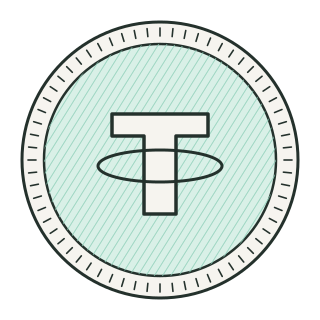

<div align="center">



# What is USDT?

</div>

A scroll-through explainer of USDT. Each chapter pairs a drawing of the token with plain-language copy taken from Tether’s terms, fee schedule, FAQ, and transparency page.

The site is not affiliated with Tether. Figures are copied from Tether’s public pages and can change. The Ethereum contract’s decimal count was read from the contract Tether publishes.

## Run it

```bash
pnpm install
pnpm dev
```

Open [http://localhost:3000](http://localhost:3000).

| Script | What it does |
| --- | --- |
| `pnpm dev` | Start the dev server |
| `pnpm build` | Production build |
| `pnpm start` | Serve the production build |
| `pnpm lint` | Run ESLint |

The package manager is [pnpm](https://pnpm.io) 12.

## Where things live

- [`lib/chapters.ts`](lib/chapters.ts) — chapter copy, glossary entries, and source links
- [`lib/facts.ts`](lib/facts.ts) — circulation, reserves, fees, and the Ethereum contract address, copied from Tether’s pages
- [`components/explainer/`](components/explainer/) — scroll layout, chapter navigation, text, and the coin drawing
- [`app/page.tsx`](app/page.tsx) — the single page, which renders the explainer

When Tether’s published numbers change, update `lib/facts.ts`. The dates in that file are the dates of the source pages.

## Stack

[Next.js](https://nextjs.org) 16, React 19, TypeScript, and Tailwind CSS 4.
